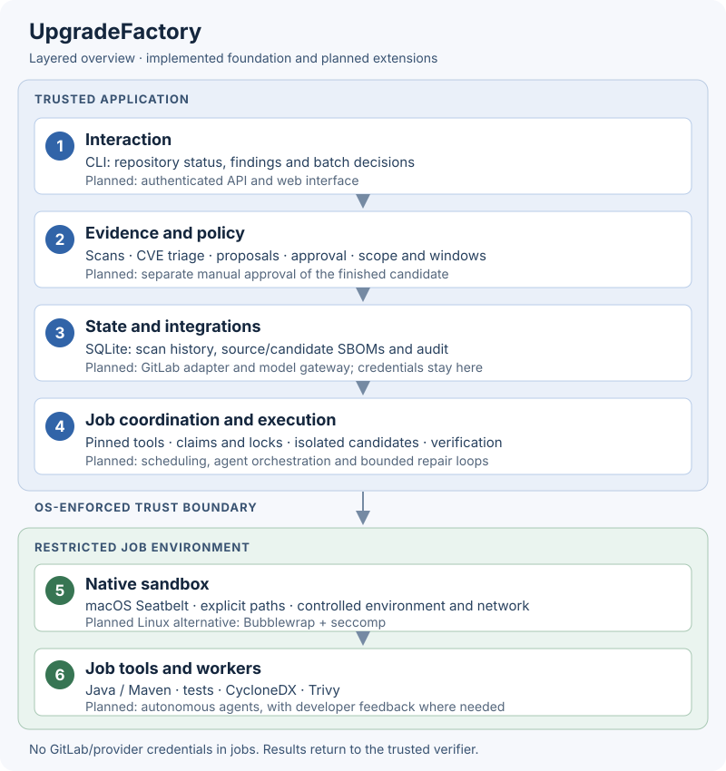
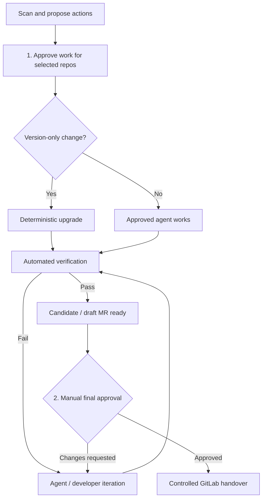

# UpgradeFactory — Rust + native sandbox

A self-contained tool for SBOM generation, vulnerability scanning and centrally
approved upgrades across Java repositories. **Rust with native sandboxing — no
Docker, Compose or Python dependency.** The current binary is named `upgrade-lab`.

## Architecture overview



The upper layers form the trusted control plane; tools and future agent workers
run below the OS sandbox boundary. These are conceptual layers, not a literal
call chain: approval records and credentials remain outside jobs, and results
return to the trusted verifier. Features labelled **Planned** are not implemented.

See [Architecture and next steps](#architecture-and-next-steps) for the main
workflow: approve repository work, let automation or an agent complete it,
iterate with a developer where needed, then manually approve the finished result.

## Status

The Rust implementation includes a tested **macOS sandbox** and an initial
**tool manager for JDK, Maven and Trivy**:

- Seatbelt through the fixed system path `/usr/bin/sandbox-exec`.
- Deny-by-default access, explicit filesystem permissions and networking disabled by default.
- Child processes inherit the sandbox restrictions.
- A cleared inherited environment, private temporary HOME, TMPDIR and working directory.
- Timeouts and process-group termination.
- A self-test before user commands. Failure stops execution; there is no unsandboxed fallback.
- SHA-256 verification of tool archives using `sha2`, with dependencies pinned in `Cargo.lock`.
- Sandboxed HTTPS downloads and extraction, without global installations.

It also provides **local Git scanning, central CVE status and an SBOM inventory in
SQLite**, parallel jobs, failure classification and bounded retries.

The CLI supports remediation proposals, Critical alerts, batch approval, execution
windows and an audit log. An initial executor handles approved direct dependency
version changes.

**Still to implement:** agent-led code migration and dependency replacement,
developer feedback, recorded manual final approval, GitLab integration and a web interface. Scanning and queue operations do not start fixes
automatically; `factory run` is required. There is no Rust `serve` command yet.

The earlier Python/container prototype has been removed. Its history remains in Git.

## Build and test

Rust/Cargo is required to build the development version. End users can run a
pre-built, platform-specific binary without installing Rust.

```sh
cargo test
cargo clippy --all-targets -- -D warnings
cargo build --release
./target/release/upgrade-lab sandbox doctor
```

The macOS tests use **real Seatbelt**, not a simulated sandbox. They check file
access, inherited child-process restrictions, denied and explicitly permitted
local TCP connections, and timeouts. `doctor` checks file access and inheritance;
it does not yet perform the network probe. If the OS backend does not work, these
tests fail rather than silently skipping their checks. The separate real-tool
integration test requires explicit invocation, as described below.

## Factory definition

[`factory.yaml`](factory.yaml) describes the factory in one place: repositories,
branch routes, job settings, toolchains, agents/models, approvals and GitLab/Jira
integration targets. Defaults can be overridden per repository. Credentials are
references, never token values.

```sh
./target/release/upgrade-lab config validate --file factory.yaml
./target/release/upgrade-lab config plan --file factory.yaml
```

Validation checks the contract without contacting providers or starting work.
The effective plan identifies implemented and declarative-only settings. The
scanner now consumes repository selection, branches, scan concurrency and retry
settings from this file. Agent execution, branch promotion, Jira transitions and
other orchestration settings remain planned; `enabled: true` does not implement
a missing adapter. See the [configuration reference](docs/configuration.md).

## Quick start: real end-to-end test on macOS ARM64

```sh
./target/release/upgrade-lab tools bootstrap
./target/release/upgrade-lab smoke --network
```

`bootstrap` downloads the pinned archives in `tools/macos-aarch64.json`, verifies
SHA-256 and installs them without Homebrew or Docker. If a tool is already
installed, its receipt must match the catalogue's archive hash. This does not
re-hash the installed files. The catalogue currently supports macOS ARM64 only:

- Temurin JDK 21.0.13.1+2
- Apache Maven 3.9.9
- Trivy 0.76.2

The source is publisher release metadata, not cryptographically verified publisher
signatures. For Maven, the publisher's SHA-512 was verified first, then SHA-256 was
calculated from that same archive. Provenance is documented in the catalogue.

Each `smoke` invocation creates a new test repository under
`.lab/smoke-runs/<id>/`, saving build, SBOM and scan logs alongside `report.json`.
The fixture contains two JUnit tests and the deliberately old test dependency
commons-lang3 3.12.0. The scan must detect **CVE-2025-48924**.

`completed_with_findings` means the test pipeline works, **not** that the repository
is secure. The smoke command performs no upgrades, approvals or merge requests.
The target version, 3.18.0, comes from the vulnerability database.

Once dependencies and the Trivy database are cached, repeat the test without
network access:

```sh
./target/release/upgrade-lab smoke
```

Seatbelt then denies network access. The build runs Maven offline. The CycloneDX
plugin requires Maven's online mode even with a warm cache, so it starts without
`-o`, but the sandbox still blocks networking. Missing cache entries cause failure,
not a fallback to network access. Trivy uses its existing database without updating it.

**Verified on the development machine:** installation of all three real archives,
version checks, two passing Java tests, a CycloneDX 1.6 SBOM, a real Trivy finding
and a complete repeat with networking disabled.

## Central CVE status across 20 repositories

Create separate test repositories. Existing local repositories in `.lab/repos/`
are left untouched. All 20 new repositories contain the same deliberately old
dependency and two Java tests; they do not yet represent distinct business
services or individual failure scenarios.

```sh
./target/release/upgrade-lab repos init-examples
./target/release/upgrade-lab scan --config factory.yaml --network
./target/release/upgrade-lab status
./target/release/upgrade-lab status --repo order-service --json
./target/release/upgrade-lab status --cve CVE-2025-48924 --json
```

`init-examples` creates `.lab/rust-repos/` and a legacy JSON repository list in
`.lab/repositories.json`; it does not overwrite `factory.yaml`. Existing directories
and configuration files are retained. Interrupted initialisation may require
manual cleanup of incomplete examples.

Edit the repository section of the full factory file to select your local sources:

```yaml
repositories:
  - name: order-service
    path: .lab/rust-repos/order-service
    scan_branches: [develop, main]
```

The example factory scans two branches in each of 20 repositories: 40 jobs.
YAML paths and application state are anchored to the factory file's directory;
run other CLI commands there to use the same `.lab` state. `..` is rejected.
Repository name plus branch forms the inventory identity; an existing identity
cannot later point to another local path. Current scans support `main`/`develop`;
staging promotion and remote checkout remain planned.

Legacy JSON lists are still accepted with `scan --config .lab/repositories.json`;
those paths remain relative to the caller's working directory.

### Execution and results

- Up to eight concurrent jobs, with four by default.
- Only the branch's exact committed Git snapshot is scanned. Local changes and
  untracked files are excluded; the source repository is left untouched.
- Git and extraction also run under Seatbelt. Apple Git/Xcode Command Line Tools
  must be available; Rust-integrated or bundled Git remains future work.
- Build/tests, CycloneDX and Trivy run in the job's own writable directory.
- Database: `.lab/scans.sqlite`, retaining history by repository, branch and commit.
- Reports, source snapshots, SBOMs and logs: `.lab/scans/<id>/`.
- `scan` writes a JSON object containing `runs` and `infrastructure_errors` to
  stdout; progress goes to stderr. Exit code 1 means at least one job failed.
- An SBOM enters the central source inventory only after a fully successful scan.
  Partial artefacts from failed runs may remain in the job directory, but do not
  replace previously verified inventory entries.

Without `--network`, jobs use existing caches with networking denied, just like the
smoke test. On a fresh installation, run an online smoke test first to populate
dependencies and the database. Scan results are not uploaded to a reporting
service, but network-enabled tools may contact their dependency/database sources.
Jobs must not receive production secrets.

`status` displays severity counts and the last successfully scanned commit.
`--json` includes full findings, timestamps, incidents and log paths. `--repo`
filters repositories. `--cve` filters the findings list; repository totals still
cover all findings for the selected repositories. `--max-age-seconds` controls the
freshness threshold, which defaults to one day.

**Conservative status model:**

- No successful scan: severity counts are unknown (`—`/null), not zero.
- Latest scan failed or is running: the last successful findings are marked STALE.
- Older than the freshness threshold: STALE even if the latest run succeeded.
- A successful scan may still contain CVEs. It does not mean “secure”.
- Freshness describes collection time. It does not guarantee that branch HEAD or
  the vulnerability database is unchanged or current. Scanner/database metadata
  is saved where available; offline mode explicitly uses a cached database.

### When scanning fails

Failures include the stage (`source`, `build`, `sbom`, `vulnerability_scan`),
category, message and log path. Classification partly relies on log text and is
advisory, not a definitive diagnosis.

Only recognised transient network failures, with networking enabled, receive
automatic retries: at most two additional attempts, with delays of one and two
seconds. `--retries 0` disables retries. Authentication, sandbox, build and timeout
failures, or missing caches, never trigger automatic bypasses or code changes.

After a final failure, a **local technical incident** is created or updated for
the repository/branch/failure category. A new successful scan resolves older
technical incidents; CVEs remain if they are still present in the scan. Logs are
saved for each actual attempt. Database failures are reported separately as
infrastructure failures, not as success. Interrupted processes may leave `running`
records; automatic recovery remains to be implemented.

No GitLab issues or agent jobs are created yet. This is intentional: establish
traceable, controlled failures first. An old SBOM is not automatically rescanned
as a fallback, and a failed job is never presented as a new successful scan.

Export all successful repository/commit SBOMs to a central inventory:

```sh
./target/release/upgrade-lab inventory > .lab/central-inventory.json
```

The export retains the original CycloneDX document and provenance per snapshot.
A single merged CycloneDX export has not yet been ported to Rust. This is a source
inventory, not an inventory of what is actually deployed. Candidate snapshots are
kept separately, as described below.

## Remediation queue: Critical → alert → approval → fix

These queue commands record decisions and expose blockers. They do not start
fixes. Version changes can subsequently be run explicitly with `factory run`.

```sh
./target/release/upgrade-lab queue refresh
./target/release/upgrade-lab queue list
./target/release/upgrade-lab queue list --json
./target/release/upgrade-lab queue alerts
./target/release/upgrade-lab queue audit
```

The queue updates automatically after a successful scan. `refresh` also populates
it from previously saved results without rescanning. Unchanged proposals are
reused. Each of the 20 examples has one Medium finding and receives an upgrade
proposal to 3.18.0 — **not an automatic approval**.

- Critical findings produce a terminal alert and an audit entry, even if no fixed
  version is available. `alerts` includes all current Critical findings, clearly
  marking stale data. Alert events are deduplicated per repository, branch,
  commit, CVE, package and version. Email, Slack and other push notifications are
  not connected yet.
- Other findings are collected for planned remediation.
- An automatic version proposal is created only when the scanner reports one
  explicit fixed version. Otherwise the finding remains in status/alerts for a
  manual decision. The factory does not guess a version or a solution.

### Choose the action and authorised scope

A proposal is bound to the repository, branch, exact scanned commit, CVE,
package/version, severity, selected solution, permission to change code and
verification requirements. Its complete contents have a SHA-256 ID.

The decision model supports these action types:

- `upgrade`: change a version, with or without explicit permission to adapt code.
- `adapt_code`: adapt the code within the stated scope.
- `replace`: replace the dependency; also specify `replacement`.
- `remove`: remove the dependency and adapt the code.
- `mitigate`: apply a temporary protective measure within an explicit scope.

These describe **authorised work**, not ready-made implementation recipes. Risk
acceptance is rejected until ownership, expiry and follow-up controls exist.

To choose a different solution, copy the relevant row's `proposal` object from
`queue list --json` into a file, describe the action and submit it:

```sh
./target/release/upgrade-lab queue propose --file .lab/proposal.json --by Tobias
```

Retain the finding's identity and observed values. `replace`, `adapt_code` and
`remove` require `code_changes: true` and `code_review` verification. All proposals
must require `build`, `tests`, `sbom` and `security_scan`.

Use `evidence_fixed_version` for the scanner's unchanged fixed-version string
(including an empty string if no fix is available), particularly when your chosen
target differs from the scanner's proposal. Without that field, a version
proposal's target is assumed to be the fixed version reported by the scanner.

`main` normally permits version changes only. Code or other changes require
**separately scanned develop evidence**, or `hotfix_exception: true` for a Critical
finding. The exception forms part of the content you approve; it is never granted
automatically. Changing the target branch requires a separate proposal based on
that branch's findings rather than assuming `main` and `develop` contain the same code.

Do not edit an old proposal in the database. Create a new one with `supersedes`
set to the old proposal's full ID. This blocks previous approvals of the old scope
and requires a new decision. An already approved batch must also be revoked before
the same package can receive another active action or schedule.

### Batch approval and execution windows

Use full proposal IDs. Select all valid proposals awaiting a decision, or provide
a comma-separated list with `--ids ID,ID`. Alternative actions for the same finding
must be selected explicitly; a conflicting batch is rejected in its entirety.

Critical findings can be approved for immediate handling, valid for one hour:

```sh
./target/release/upgrade-lab queue approve --ids FULL_PROPOSAL_ID --by Tobias --now
```

For other findings, select a planned window using Unix timestamps in **seconds**,
not local clock text. Replace the placeholders with actual future timestamps:

```sh
./target/release/upgrade-lab queue approve --all --by Tobias \
  --from START_UNIX_SECONDS --until END_UNIX_SECONDS
./target/release/upgrade-lab queue ready
```

`ready` displays all batches and their blockers, not only eligible jobs.
`eligible_by_scan_evidence` requires an open execution window, an unexpired and
unrevoked approval, and a successful latest scan for the same commit, finding,
severity and fixed-version evidence within 24 hours. Changed or missing evidence
blocks the batch. Multiple repositories are approved in **one atomic batch**, not
through separate per-repository approvals.

`ready` checks database evidence, not live Git HEAD. The executor performs further
Git/diff checks and an atomic claim. Already claimed batches cannot be replayed
and are shown with `execution_started: true`.

Approval is also bound to the scope policy and the built-in tool catalogue hash.
A changed catalogue or an older unbound decision requires new approval.
`merge_authorized` is always false. Approval does not close a CVE finding.

Revoke an approval with a reason:

```sh
./target/release/upgrade-lab queue revoke --batch FULL_BATCH_ID \
  --by Tobias --reason "Changed plan or remediation approach"
```

Proposals, batch decisions, revocations and audit entries live in
`.lab/scans.sqlite`. Database triggers prevent ordinary updates/deletions of
decision history. This provides **local traceability, not tamper-proof auditing**:
`--by` is not authentication, database administrators can modify the file, and no
signed external audit log exists.

## Execute an approved batch

```sh
./target/release/upgrade-lab factory run --batch FULL_BATCH_ID --workers 2 --network
./target/release/upgrade-lab factory status
```

Execution requires explicit approval within an open window. No scheduler starts
the batch automatically yet. Without `--network`, existing caches are used and
networking is denied. Up to four repository groups run concurrently. No agent is used.

The first executor supports only `upgrade` with `code_changes: false`, a regular
POM and explicit direct dependency versions. Code adaptation, replacement/removal,
properties, BOM/parent, transitive and multi-module upgrades require manual
handling. The authorised scope is never expanded automatically. Unsupported code
permissions are rejected before claiming the batch; unsupported POM structures
are reported per repository as `manual_required`.

Checks and results:

- Approval, revocation, validity, scan evidence and the tool catalogue are checked.
- An atomic batch claim and locks per registered repository path prevent duplicate execution.
- The actual target branch HEAD must still match the approved commit.
- An **independent Git clone** is created for each repository/target branch under
  `.lab/executions/`. Only the clone's candidate branch changes. The original
  repository and its branches remain read-only.
- Only the exact approved version text in `pom.xml` changes. Formatting and other
  content are preserved. The candidate's `.git` is protected as read-only during
  Maven/Trivy execution.
- Build/tests, CycloneDX and Trivy run sandboxed. Required tests must run.
- Approved target versions must appear in the SBOM. Remaining findings on upgraded
  packages and new/escalated HIGH/CRITICAL findings block the candidate.
- Diffs, file modes, Git HEAD and the exact committed POM are checked again.
  Approval and source HEAD are checked between stages and after verification.
- Success yields `verified_candidate`; additional transitive dependency changes
  yield `awaiting_dependency_review`. Both are local candidates, not merge decisions.
- Each group receives logs and `report.json`. A failure does not automatically
  block other valid groups. The final report includes every result.
- Candidate SBOMs are stored separately and exported as `candidate_snapshots`, with
  role, target branch, commit and verification status. They do not replace source
  branch SBOMs.

There is **no push, merge request or merge**. CVEs are not closed on the target
branch simply because a candidate passes verification. `factory status` reports
the candidate's own Git directory, branch and commit. The original repository's
`git branch` therefore does not show the candidate branch.

A batch can be claimed only once. Failure requires a new controlled decision;
there is no automatic replay. A crash after claiming retains `running` and the
locks for manual investigation. Automatic recovery, cancellation and lease
management remain future work. Revocation stops work at the next check, not
immediately in the middle of a running process.

**Tested:** 37 standard tests and a separate real integration test that upgrades a
temporary repository from commons-lang3 3.12.0 to 3.18.0, builds it, runs tests,
produces an SBOM and scans it with Trivy. It checks that the original Git HEAD/POM
remain unchanged, that the target branch's CVE remains in status, and that the
batch cannot be replayed. The integration test requires bootstrapped tools and a
cached database:

```sh
cargo test execution::tests::real_approved_upgrade_does_not_modify_original_or_close_main_finding -- --ignored --nocapture
```

That test approval exists only in a temporary database. It does not approve your
20 queued proposals. The remaining security limitations below, including shared
caches, process groups and the lack of hard quotas, also apply to the factory.

## Run a CLI command in the sandbox

```sh
./target/release/upgrade-lab sandbox run -- /bin/echo sandbox-ok
./target/release/upgrade-lab sandbox run --timeout 5 -- /bin/sh -c 'while :; do :; done'
```

Grant only the paths required for the current job. Paths must exist and are
normalised before the profile is generated:

```sh
./target/release/upgrade-lab sandbox run \
  --read /absolute/path/to/input \
  --write /absolute/path/to/job \
  --timeout 60 -- /bin/sh -c 'cat "$1/data.txt" > "$2/result.txt"' \
  job /absolute/path/to/input /absolute/path/to/job
```

The executable must have an absolute path. Its file becomes readable and
executable, but its whole installation directory is not automatically exposed.
Libraries and tools outside the system runtime need explicit grants.

The inherited environment is cleared. HOME and TMPDIR point to the job's temporary
directory. Arbitrary host variables, such as GitLab tokens, are not passed on.
`tools run` sets a controlled JDK/Maven environment without inheriting the host's
configuration.

Networking is disabled. `--network` permits outbound traffic, **not** a restricted
list of domains. Do not use this flag for jobs handling secrets.

Commands return their exit code; a timeout returns 124. Terminal output is limited
to 64 KiB per stream. Temporary log files are removed afterwards.

## Install tools in the application's own directory

Select official archives for **macOS and the correct CPU architecture**. Obtain
SHA-256 from a trusted source. A hash from the same compromised source does not
protect against a supply-chain attack. No fabricated checksums or automatically
selected versions are used. Use the reviewable catalogue above or supply your own
archives. Replace the placeholders with actual values:

```sh
./target/release/upgrade-lab tools install jdk JDK_VERSION \
  --archive /absolute/path/jdk.tar.gz --sha256 TRUSTED_SHA256
./target/release/upgrade-lab tools install maven MAVEN_VERSION \
  --url https://official-server/maven.tar.gz --sha256 TRUSTED_SHA256
./target/release/upgrade-lab tools install trivy TRIVY_VERSION \
  --archive /absolute/path/trivy.tar.gz --sha256 TRUSTED_SHA256
```

The archive is copied into staging, or downloaded using sandboxed system curl,
verified with SHA-256 and extracted using sandboxed system tar. Absolute member
paths, `..`, external/absolute symbolic links and special files are rejected.
Extraction has no network access. Existing installations are not overwritten.
This uses macOS system tools `/usr/bin/curl` and `/usr/bin/tar`, not Homebrew versions.

Tools live in `.lab/tools/<kind>/<version>-<os>-<arch>/`. An installation receipt
records the version label and archive hash. The label does not prove the tool's
actual version: check its version command separately. Installed files are neither
signed nor re-hashed on every invocation. Only the trusted application should
modify the installation directory.

```sh
./target/release/upgrade-lab tools run jdk JDK_VERSION -- -version
./target/release/upgrade-lab tools run maven MAVEN_VERSION --jdk JDK_VERSION -- --version
./target/release/upgrade-lab tools run trivy TRIVY_VERSION -- --version
```

Maven receives read-only access to its own installation and the JDK. Controlled
JAVA_HOME/PATH values are set, and the dependency cache points to
`.lab/cache/maven/repository`. Trivy uses `.lab/cache/trivy`. Networking remains
disabled unless explicitly enabled. For a trusted test repository:

```sh
./target/release/upgrade-lab tools run maven MAVEN_VERSION --jdk JDK_VERSION \
  --repo /absolute/path/to/test-repo --network -- -B clean verify
```

This grants write access to **that repository copy** and the tool cache, not the
home directory. Use a separate working copy, not a repository containing secrets.
The application's overall data directory, or a parent of the tools directory, is
rejected as a repository grant.

Tool execution currently has a 15-minute timeout. Version checks need neither a
repository nor network access. Caches are shared between jobs; per-job cache
isolation remains future work. Neither `~/.m2/settings.xml` nor private registry
configuration is inherited.

The installation pipeline is also tested using a small local archive and a
harmless fixture tool. Tar archives are supported; pkg and zip installation flows
are not included. Archive listings are limited to 16 MiB, but the total extracted
size does not yet have a quota.

## Security boundaries

This is an early implementation, not a security-audited build platform:

- The sandbox is an OS policy, not a virtual machine. It relies on macOS security mechanisms.
- The system runtime is readable. File metadata is generally readable; this does
  not guarantee that filenames or machine information are hidden.
- Ordinary read/write grants are additive: a writable parent also makes its
  children writable. A narrower read grant alone does not make a child read-only.
  The executor's explicit `.git` write-denial rules are a separate protection.
  Do not expose the home directory or filesystem root. A grant for `/` is rejected.
- CPU/memory usage and log file sizes do not yet have hard quotas. The display
  limit on logs does not limit disk consumption.
- Timeout handling terminates the process group, but does not guarantee the
  termination of children that actively escape it. Stronger lifecycle management
  remains future work.
- Every command still needs an appropriate, narrow set of filesystem permissions.
- The Seatbelt interface is deprecated and must be regression-tested on supported
  macOS versions.
- **The Linux backend is not implemented:** jobs are refused on Linux. The planned
  backend is Bubblewrap plus seccomp, following the architecture used by Codex.

## Architecture and next steps

The [layered overview](#architecture-overview) shows the system structure. The
single workflow below shows how people and automation should work together.

### Target workflow: authorise work, then approve the result

**There are two different approvals:** permission to perform work on selected
repositories, and manual approval of the finished changes. Permission to run an
agent is not approval of whatever it produces.

This is the **target workflow**, not a claim that every step exists today. Agent
execution, the developer feedback loop, recorded final approval and GitLab delivery
are still planned.



The agent should complete as much work as possible before asking for attention.
The operator reviews a finished candidate, not a stream of routine tool requests.
A developer may then provide feedback, work with the agent or edit the candidate
directly. Once the agent and any participating developer have finished, the exact
result returns for manual final approval.

### 1. Approve the work for each selected repository

The factory collects findings and proposes actions automatically. Simple version
changes use the deterministic executor. Repositories needing code adaptation,
dependency replacement or other non-trivial changes need explicit permission for
an agent to perform that work.

One batch decision can cover all or selected repositories, while preserving a
separate scope for each repository: target branch, base commit, chosen action,
permitted code/configuration/test changes, verification requirements and budgets.
The operator can choose agent-led work or developer-assisted work; neither route
requires approval of every individual command.

- **Critical:** alert immediately → approve the selected action → start within the
  approved immediate window. Do not wait for agent analysis before raising the alert.
- **Other findings:** collect proposals → approve selected work → execute during
  the planned window.
- **No approval:** do not start a fix. A missing fix version must not hide a
  Critical alert or cause the factory to invent an upgrade.

An unsuccessful version bump must not silently grant an agent permission to
change code. If that permission is missing, propose the wider scope and obtain a
new work approval. `main` remains version-only by default; code changes require
separately scanned `develop` evidence or an explicit Critical hotfix exception.

### 2. Let the agent work within that mandate

After approval, the coordinator claims the job, checks current evidence and Git
HEAD, locks the repository and prepares an independent candidate. The agent works
in the sandbox and may inspect code, edit permitted files, build, test and repair
its own changes automatically within the approved scope and limits.

Routine tool checks and bounded repair attempts are machine-controlled. Human
intervention is needed when the agent is blocked, exhausts its budget or needs a
materially different action, broader permissions or an expired/revoked approval.
Those situations produce a clear handover or a new work proposal, not a silent
policy change. The agent must not disable tests, weaken the sandbox or alter its
own approval or audit records.

Model-provider and GitLab credentials remain outside jobs in trusted gateways and
adapters. The model gateway must enforce data-sharing policy and cost limits;
a filesystem sandbox alone does not control which source code is sent to a model.

### 3. Review a completed candidate and give feedback

Before requesting attention, the factory runs independent checks and assembles a
review package: exact diff, change summary, build/test results, SBOM changes,
remaining/new findings and any known limitations.

A developer is **optional, not a mandatory stop at every stage**. The normal path
is an autonomous agent producing a reviewable result. If feedback or additional
engineering is needed, the developer and agent can iterate on the candidate.
Every new revision returns through automated verification. In-scope feedback does
not need another execution approval; a changed solution or wider mandate does.

A failed scan remains a failure, not a clean result. Failed or incomplete agent
work retains its logs and findings for follow-up. Exhausted attempts result in a
manual handover; there is no automatic risk acceptance.

### 4. Manually approve the finished result

Once the agent and any participating developer are satisfied, an operator manually
approves the **specific verified candidate**, separately from the earlier work
approval. The final approval must bind the candidate commit and its verification
evidence, not just the repository name or the fact that an agent has finished.

Further edits or review feedback invalidate that final approval. The revised
candidate must be verified again and submitted for another manual final approval.
The agent cannot approve its own result.

The trusted GitLab adapter may prepare or update a draft MR automatically when
the candidate is ready, so feedback can happen there without another administrative
approval. Final approval applies to the reviewed revision; neither initial work
approval nor a clean candidate implies automatic merge permission. MR/CI feedback
can feed back into the same controlled iteration; new changes require renewed
final approval. Only a successful scan of the resulting target-branch commit establishes
that a finding is absent there. Candidate SBOMs remain separate from source-branch
inventory, and deployment verification is a separate concern.

### The factory orchestrates branch promotion

The intended branch strategy is configured in `factory.yaml`:

| Route | Base and promotion | Handover |
|---|---|---|
| Normal upgrade | Create `upgrade/<branch_id>` from `develop`; after final approval, merge approved repository MRs into `develop`, then promote to `stage`. | Once all selected repositories are staged and verified, transition their Jira issues to `ready-for-at-test`; the ordinary test/release process then governs `main`. |
| Critical patch | Create the upgrade branch from `main`, verify through an isolated main-based staging ref, promote the patch to `main`, then backmerge to `develop`. | Preserve normal pipeline checks without dragging unrelated shared-stage changes into production. |

The factory's job queue drives this repo by repo and step by step. It records
MRs, commits, pipeline/deployment evidence and completed operations, retries only
eligible failed steps, and never repeats a recorded successful merge blindly.
The operator approves centrally; routine per-repository GitLab administration is
not a separate manual task. Merge results must be checked before further promotion.

Agents may handle code changes and general maintenance/framework/JDK upgrades,
not only CVE-generated version proposals. Developer decisions belong **inside**
the working loop, before final approval. When the agent and participating developer
have finished, the exact candidate receives manual final approval.

This orchestration, non-CVE intake, agent/developer integration, promotions and
Jira handover are configuration contracts, not implemented adapters yet.

### Implementation boundary and next steps

| Available now | Still to implement |
|---|---|
| Factory YAML validation, effective-plan output and scan configuration | Applying the full definition to durable orchestration jobs |
| Scan evidence, SBOM inventory and concise CVE status | Agent execution for non-trivial upgrades |
| Immutable proposals and batch work approvals | Agent/developer feedback and candidate revision tracking |
| Execution windows, revocation, claims and repository locks | Recorded manual final approval bound to candidate evidence |
| Sandboxed direct version changes and candidate verification | GitLab MR/issue integration and approval-aware delivery |
| Failure logs, bounded scan retries and audit history | Scheduling, recovery and stronger job/cache/resource isolation |

The next implementation should follow this workflow: add the approved agent
executor, retain a finished candidate for developer feedback, reverify revisions,
then record manual final approval of the reviewed revision. Automate draft-MR
preparation and routine handovers rather than adding approval gates for them. Keep the CLI status
list as the main overview; a future API or web interface should expose the same
workflow rather than introduce extra approval stages.

The trusted Rust application owns policy, evidence and credentials. Jobs receive
only their working copy and necessary tools. Linux sandbox support remains
planned; see [Security boundaries](#security-boundaries) for the current limits.

The reference architecture was studied in `../codex/codex-rs/sandboxing/` and
`../codex/codex-rs/linux-sandbox/`. Our minimal Seatbelt policy is our own code;
the full Codex implementation has not been copied or integrated.

## Licence

Copyright 2026 Tobias Martelius.

The project's own code and documentation are licensed under the
[Apache License 2.0](LICENSE.md). Third-party dependencies and downloaded tools remain
subject to their respective licences.

The software is provided as is, without warranties. See sections 7–8 of the
licence for the warranty disclaimer and limitation of liability, subject to
applicable law.

Review and test generated changes before merging or deploying them. Use backups
and restricted permissions. Scanning does not guarantee that every vulnerability
will be found or fixed, and sandboxing does not replace a security review.
